# OpenDesign 架构与流程

> 配套阅读：[README.md](./README.md)
> 所有图均为 Mermaid 格式，可在支持 Mermaid 的 Markdown 渲染器 (GitHub, Notion, VSCode + 插件, Typora 等) 中直接查看。

---

## 一、整体架构图

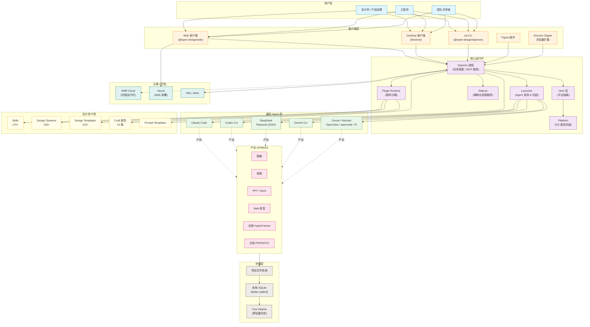

---

## 二、分层架构图

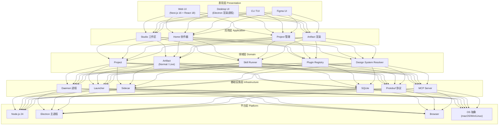

---

## 三、核心领域模型图

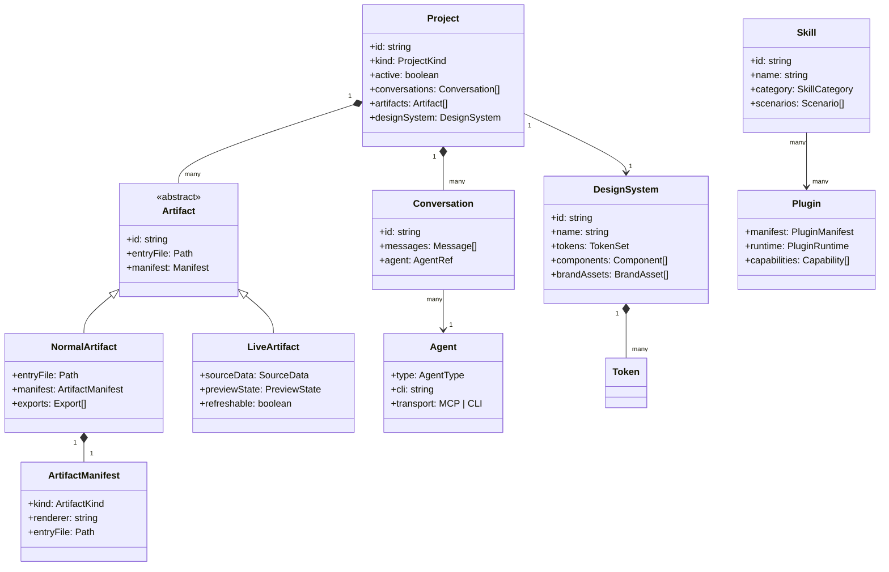

---

## 四、创作流程 (Brief → Artifact)

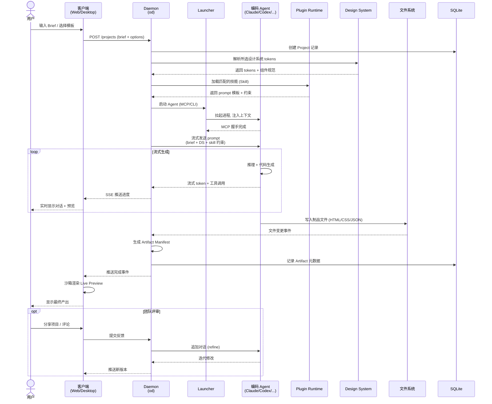

---

## 五、插件加载流程

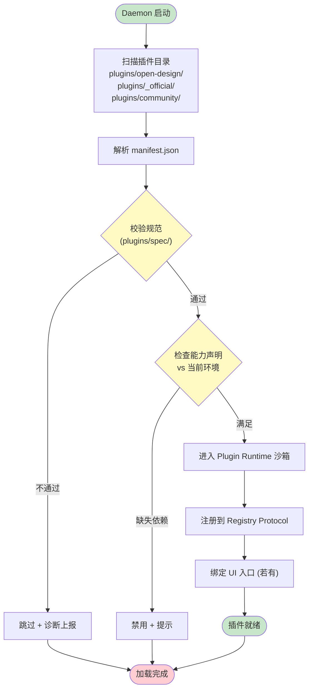

---

## 六、Agent 接入架构

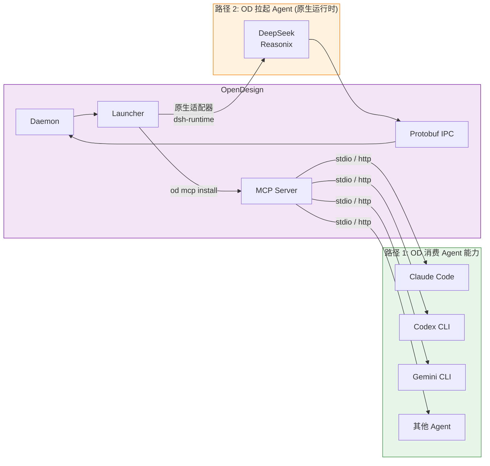

---

## 七、部署拓扑

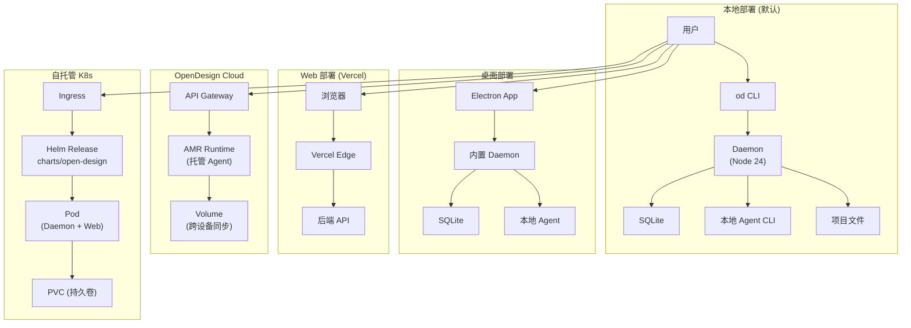

---

## 八、数据流：Brief 到 Artifact

```mermaid
flowchart LR
    A["Brief<br/>(文本/URL/素材)"] --> B["Home Composer<br/>选择 Media Surface"]
    B --> C["Chip Rail<br/>选择场景/技能"]
    C --> D["Project 创建"]
    D --> E["Design System<br/>Resolver"]
    E --> F["Skill Loader"]
    F --> G["Prompt 合成<br/>(brief + DS + skill)"]
    G --> H["Agent Dispatch<br/>(Launcher)"]
    H --> I["流式生成"]
    I --> J["File Writer"]
    J --> K["Manifest 生成"]
    K --> L["Artifact 注册"]
    L --> M["Live Preview<br/>沙箱渲染"]
    M --> N{用户评审}
    N -- 通过 --> O["导出<br/>(PNG/PDF/MP4/HTML)"]
    N -- 迭代 --> G

    style A fill:#bbdefb
    style O fill:#c8e6c9
    style N fill:#fff9c4
```

---

## 九、技能分类与调用关系

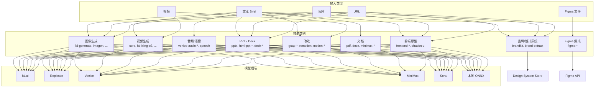

---

## 十、发布流程

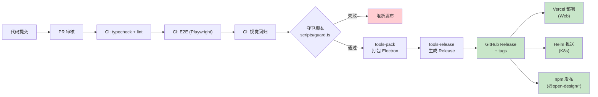

---

## 十一、关键设计决策

| 决策 | 选择 | 原因 |
|---|---|---|
| Monorepo 工具 | pnpm workspaces | 严格依赖隔离 + 快速链接 |
| 类型系统 | TypeScript 7 native | 更快编译，原生支持 |
| 前端框架 | Solid.js | 细粒度响应式，性能优于 React |
| 进程模型 | Daemon + Sidecar | 长连接辅助服务与主进程解耦 |
| Agent 协议 | MCP + Protobuf IPC | MCP 通用性 + Protobuf 高性能 |
| 本地存储 | SQLite | 单文件、零依赖、跨平台 |
| 插件沙箱 | Plugin Runtime | 隔离社区代码，保护宿主 |
| 设计系统分发 | 目录 + manifest | 可 git diff、可检视、可 fork |
| 部署 | Docker + Helm + Vercel | 覆盖本地/云/边缘三种场景 |
| DeepSeek 集成 | 原生运行时 (dsh-runtime) | 一等公民待遇，结构化流式 |

---

## 十二、扩展点

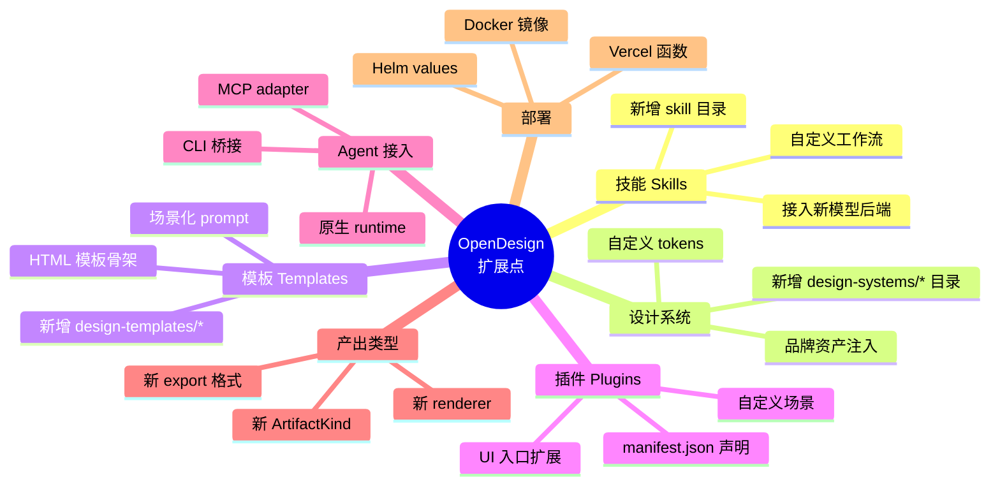

---

## 十三、结论

OpenDesign 的架构体现了几个核心工程哲学：

1. **Local-first, cloud-optional**：默认本地运行保障隐私与低延迟，云端作为可选增强
2. **Agent-agnostic**：通过 MCP 抽象，不绑定任何单一 AI 提供商，支持 26+ Agent CLI
3. **Asset-rich**：171 技能 × 154 设计系统 × 116 模板，构成庞大的可组合设计资产库
4. **Process-isolated**：Daemon / Sidecar / Plugin Runtime / Agent 进程各司其职，故障隔离
5. **Protocol-driven**：protobuf 定义 IPC，MCP 定义 Agent 通信，manifest 定义插件/制品契约
6. **Design-engineering 融合**：`craft/` 目录把设计工艺 (排版/色彩/UX 定律) 提升到与代码同等地位
7. **Test-driven quality**：55 个 CI 工作流，双层架构 (业务层 + 原子能力层)，20+ Agent CLI mock，Playwright 视觉回归
8. **Release discipline**：四级发布通道 (beta → prerelease → preview → stable)，macOS Intel 签名作为 stable gate

该架构适合作为 **AI+设计协作** 领域的参考实现，也适合作为 **多 Agent 编排系统** 的学习样本。
